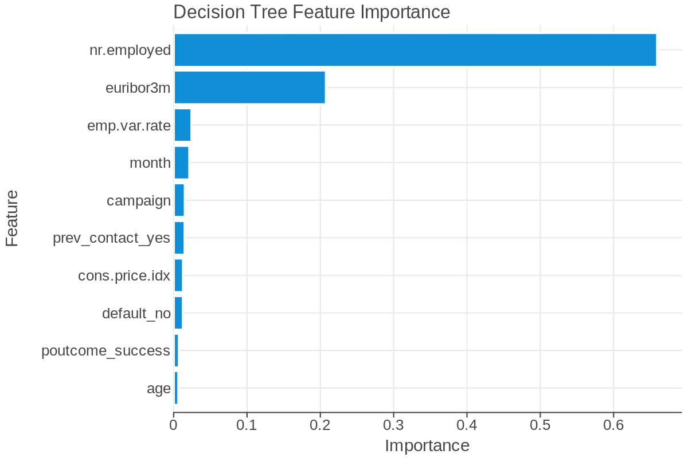
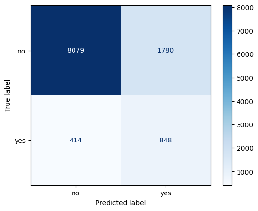

## Problem

Banco Federal de Finanças had just finished an ineffective telemarketing campaign. The bank asked us to show how machine learning could improve who gets called in future campaigns. We had three goals:

- identify the factors most associated with a customer subscribing
- build a model that finds the customers most likely to respond
- show that model-based targeting reaches subscribers at a much higher rate than calling people at random

## Approach

We trained a supervised decision tree on about 37,000 records from the previous campaign, with 70% for training and 30% (about 11,100 customers) held out for testing. The features fall into three groups: customer demographics, contact and timing details (including economic indicators), and the outcome of earlier campaigns. The target was whether the customer subscribed.

{fig-alt="Decision tree feature importance, led by nr.employed and euribor3m."}

The two strongest predictors were the bank's quarterly number of employees (`nr.employed`) and the 3-month Euribor rate (`euribor3m`). Both describe the economy when the customer was contacted, so the state of the economy was the best predictor of whether a customer would say yes. The month of contact ranked fourth, which surprised us and which the model cannot explain on its own.

## Results

{fig-alt="Confusion matrix on the test set: 8,079 true no, 1,780 false yes, 414 false no, 848 true yes."}

| Metric | Score |
|---|---|
| Accuracy | 80.3% |
| Precision | 32.3% |
| Recall | 67.2% |
| F1 score | 43.6% |

Only about 11.4% of customers subscribed, so a model that always predicted "no" would score 88.7% accuracy and find nobody. We trained with balanced class weights on purpose, which lowers accuracy but finds subscribers. The model found 848 of the 1,262 subscribers in the test set (67.2%). About one in three customers it flagged actually subscribed, which is roughly 2.8 times the random rate of one subscriber in nine calls. The cost is 1,780 calls to customers who did not subscribe.

## Other findings

- **Prior contact:** the share of customers who said yes was about the same whether or not they had been contacted before, so earlier outreach did not appear to backfire.
- **Privacy:** the data contains no names, birth dates, locations, government identifiers, contact details, or account specifics, so it is consistent with GDPR.
- **Limits:** the data is historical and the economic features are correlated with each other, so the model should be retrained as conditions change. Adjusting the classification threshold or tree depth would shift the balance between missed subscribers and wasted calls.

[View the full notebook](group_bank.ipynb)
