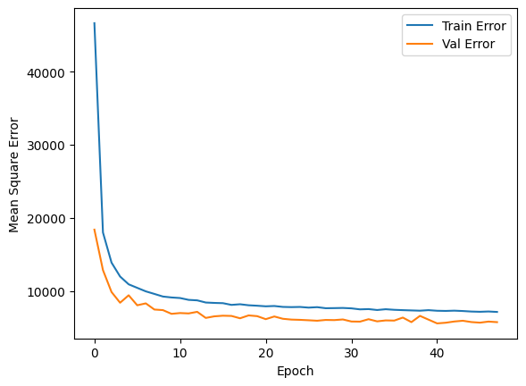
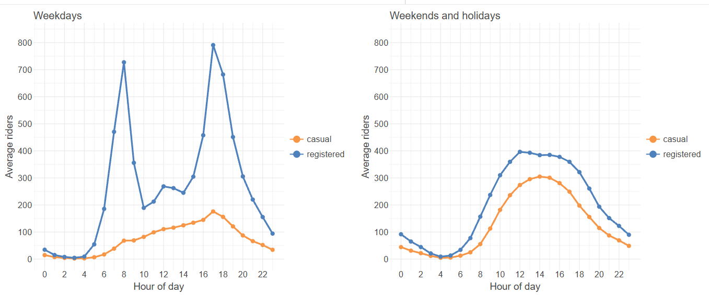
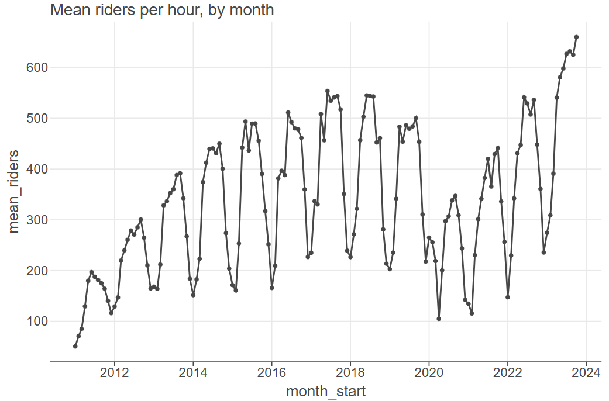
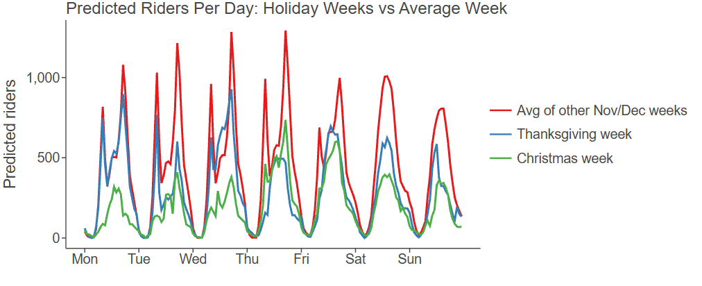

## Problem

WelcomeBike, a bike rental company in Washington, D.C., wanted to forecast how many riders to expect per hour and per day over the November and December holidays. We used hourly rental data from January 2011 to September 2023, including the date, hour, weather, and rider type.

## Cleaning and features

- Split the date into day, month, and year, and combined casual and registered riders into one total.
- Added **days from Thanksgiving** and **days from Christmas**, which raised R² on a small holdout by about 0.10.
- Added a **COVID flag** for March 2020 through December 2021.
- Scaled features with min-max scaling so variables like windspeed (0 to 70) and rider counts (0 to 1,000+) start on equal footing. Z-score scaling gave almost the same result.

A mistake that taught us something: our first model scored nearly 100% because we forgot to remove the casual and registered columns after adding them together, so the model had simply learned to add. We caught it because the result was too good, removed the columns, and rebuilt.

## Model

A neural network with two hidden layers using ReLU activations: 150 nodes with 40% dropout, then 32 nodes with 20% dropout. Dropout guards against overfitting. We trained on mean squared error with a batch size of 80, a learning rate of 0.0008, and early stopping with patience of 7. Training stopped at 48 of a possible 100 epochs once the validation error stopped improving, and we kept the weights from the best epoch.

{fig-alt="Training and validation error falling steadily and leveling off by about epoch 48."}

We also tried training on November and December alone, on the theory that holidays behave differently, but there was not enough data to make an accurate model.

## Results

| Metric | Score |
|---|---|
| R² | 0.951 |
| RMSE | 75.2 riders |
| MAE | 46.7 riders |

The model explains about 95% of the variation in riders at a given hour, with a typical miss of about 47 riders.

{fig-alt="Average riders by hour: weekdays peak at 8 am and 5 pm, while weekends form a single midday hump."}

{fig-alt="Mean riders per hour by month from 2011 to 2023, showing a yearly cycle, a dip in 2020, and a rising trend."}

{fig-alt="Predicted riders per day for an average November and December week, Thanksgiving week, and Christmas week."}

## Recommendations

- **Plan for rush hours.** Weekday demand peaks at 8 am and 5 pm, while weekends are a smooth midday curve, so renting the same number of bikes at the same hours on weekends would lose revenue.
- **Expect growth over years, not months.** Demand dips every year in November and December, but the long-run trend in D.C. is rising.
- **Supply fewer bikes around holidays.** Thanksgiving week should run slightly below other November weeks, and Christmas week should look like a series of weekends with far fewer riders.

[View the full notebook](bike-demand-notebook.ipynb)
