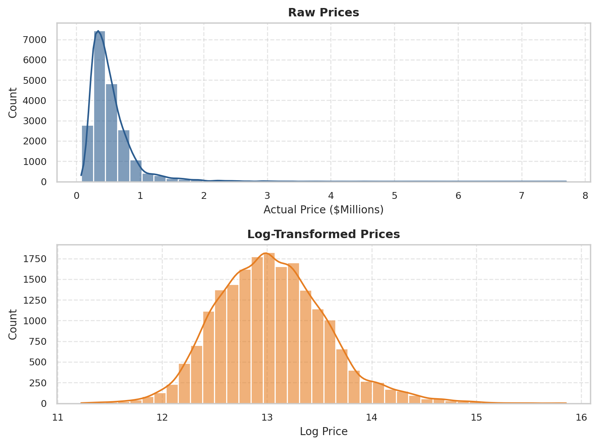
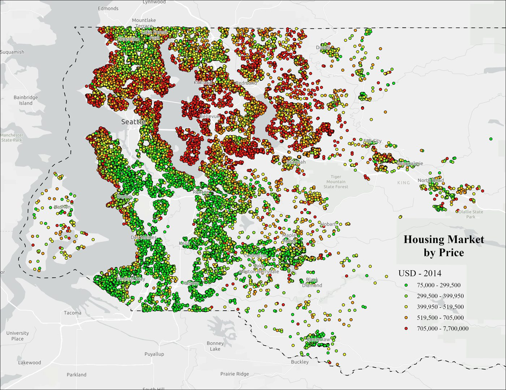
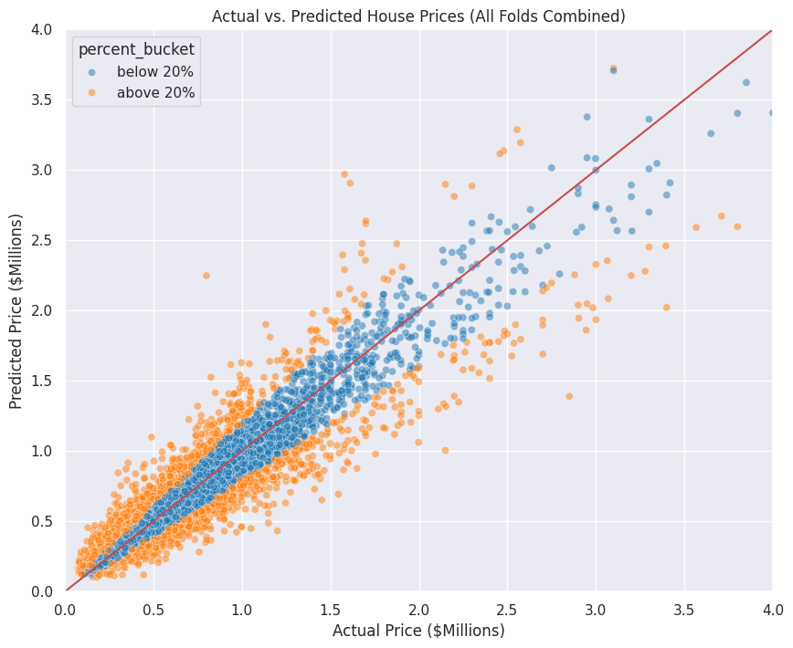
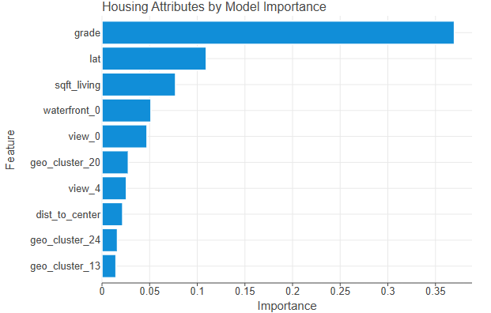

## Problem

A client in the housing and insurance space asked for a model that predicts home prices in King County, Washington, using sales from January 2014 to December 2015. The data includes bedrooms, bathrooms, floors, living area, lot size, year built, renovation year, view, waterfront, and a construction grade.

## Cleaning and features

- Split the sale date into separate month and year features and dropped the day, which did not help the model.
- Kept the construction **grade** (1 to 13) as a number instead of binning it. The model improved because grade is an ordered ranking.
- Built **distance from the center of Seattle**, **house age**, and **years since renovation**.
- Tested the 30-year mortgage rate from FRED and left it out because it did not improve predictive power.
- Took the **log of price**. Raw prices are heavily right-skewed, so a few very expensive homes would dominate the error. The log shifts the model toward minimizing percentage error, and predictions are converted back to dollars afterward.

{fig-alt="Raw home prices are right-skewed; log-transformed prices are roughly bell-shaped."}

{fig-alt="Map of King County home sales colored by price, with the most expensive homes concentrated near Seattle."}

## Model

We used XGBoost, an ensemble of gradient-boosted decision trees where each tree corrects the errors of the ones before it. Our first 30% test split turned out to be biased toward homes without basements, so we switched to **5-fold cross-validation**, which trains and tests the model five times on different slices and averages the results.

## Results

| Metric | Score |
|---|---|
| R² | 0.898 |
| RMSE | $116,957 |
| MAE | $64,596 |
| Mean absolute percentage error | 12.1% |

About 90% of the variation in prices was explained on data held out during cross-validation. About 32% of predictions landed within 5% of the true price, 57% within 10%, and 83% within 20%.

{fig-alt="Actual versus predicted prices across all folds, with predictions within 20 percent in blue and others in orange."}

Error grows for expensive homes, with accuracy dropping above about $1.5M, because there are few of them to learn from.

{fig-alt="Top ten features by importance: grade, latitude, square footage, waterfront, view, and geographic clusters."}

Grade was by far the strongest feature (importance 0.37), followed by latitude, living area, waterfront, and view. A geographic cluster covering high-end downtown Seattle was also important.

## Recommendations

- Present estimates as a range instead of a single number.
- Manually review extreme high-priced outliers.
- Include distance from a major city in future models.

We also declined a request to lower estimates in low-income areas to protect insurance customers. That would have required confidential personal data and would have compromised the model's integrity. The model already reflects neighborhood conditions through features like the living area of the 15 nearest homes.

[View the full notebook](housing-prices-notebook.ipynb)
