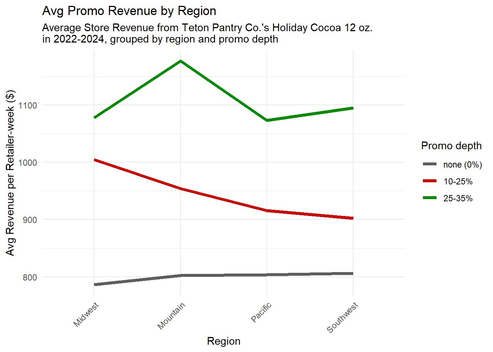
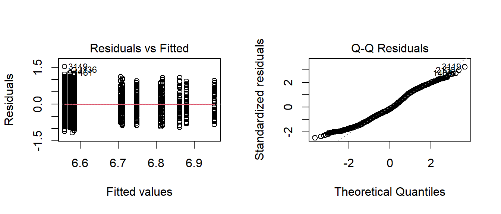

## Question

Teton Pantry Co. sells a 12 oz. Holiday Cocoa through five retailers in four regions. Regional managers disagreed about whether promotions should be deeper in some regions than others. Do promotion depth and region change weekly revenue, and does the effect of a promotion depend on the region?

## About this project

This was a role-play consulting exercise for MATH 325. The client emails, the sales data (2022 to 2024), and the cover image were generated with ChatGPT 5.1. My replies to the client and the full analysis are my own. ChatGPT was also used to help debug code, customize the graphs, and choose the statistical test.

## Approach

I built the report in R (`car`, `tidyverse`, `pander`).

- Calculated **revenue** per retailer-week as units sold times actual price.
- Grouped promotion depth into three levels: none (0%), small (10 to 25%), and medium (25 to 35%).
- Fit a two-way ANOVA with interaction on log revenue: `log(revenue) ~ promo + region + promo:region`. The log transform stabilizes the variance of the revenue data.

## Results

| Term | Df | F value | p-value |
|---|---|---|---|
| Promotion depth | 2 | 55.73 | 1.4e-24 |
| Region | 3 | 0.19 | 0.905 |
| Promotion x Region | 6 | 0.92 | 0.480 |
| Residuals | 3,732 | | |

Promotion depth is significant. Region and the promotion-by-region interaction are not, at α = 0.05.

| Promotion level | Mean weekly revenue per retailer |
|---|---|
| None | $799.80 |
| Small (10 to 25%) | $941.90 |
| Medium (25 to 35%) | $1,109 |

{fig-alt="Line chart of average weekly revenue by region for each promotion level. The three lines stay in the same order across all four regions."}

The lines for the three promotion levels keep the same order in every region, which matches the non-significant interaction. The Mountain region's medium-promo average ($1,176) is the highest point, but the test shows it is within normal variation.

{fig-alt="Residuals versus fitted values and a normal Q-Q plot of the standardized residuals from the ANOVA model."}

The residual plots show roughly even spread across fitted values and a Q-Q plot close to a straight line, so the ANOVA assumptions are reasonable on the log scale.

## Recommendation

- Promotions work: a small promotion added about $142 in average weekly revenue over no promotion, and a medium promotion added about $167 more than a small one.
- Apply the medium promotion depth (25 to 35%) consistently across all regions. There is no evidence that any region needs a different strategy.

## Tools

R, ANOVA, `car`, `tidyverse`, `pander`, ggplot2.

[Read the full report on Google Drive](https://drive.google.com/file/d/1yOpkzG6_UwPMoVR0zy8Nd51WyomOFahj/view?usp=drivesdk){target="_blank"}
