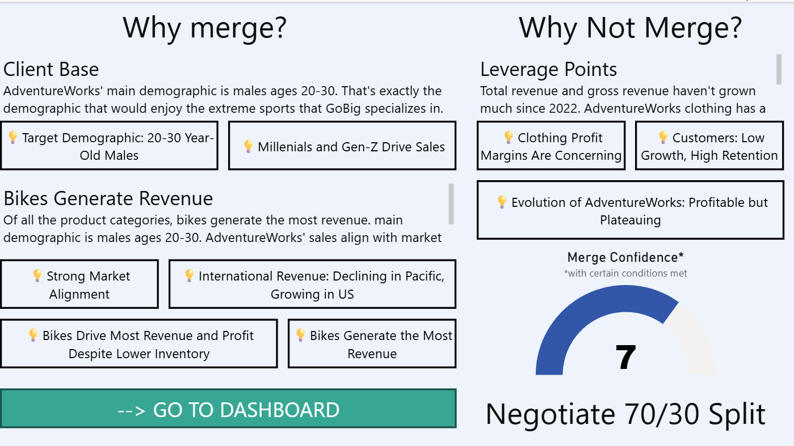
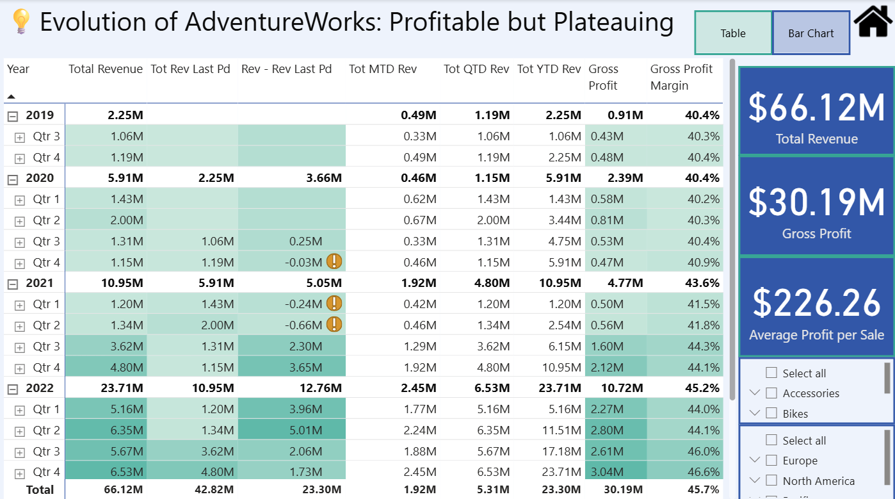
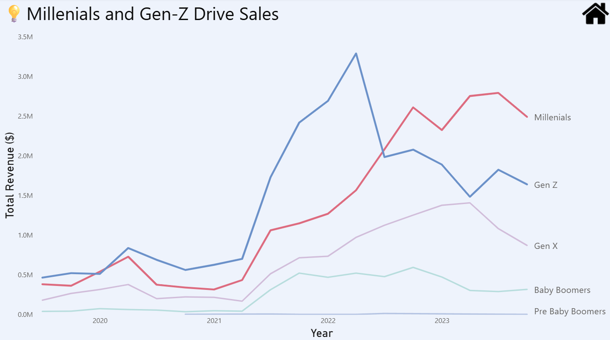
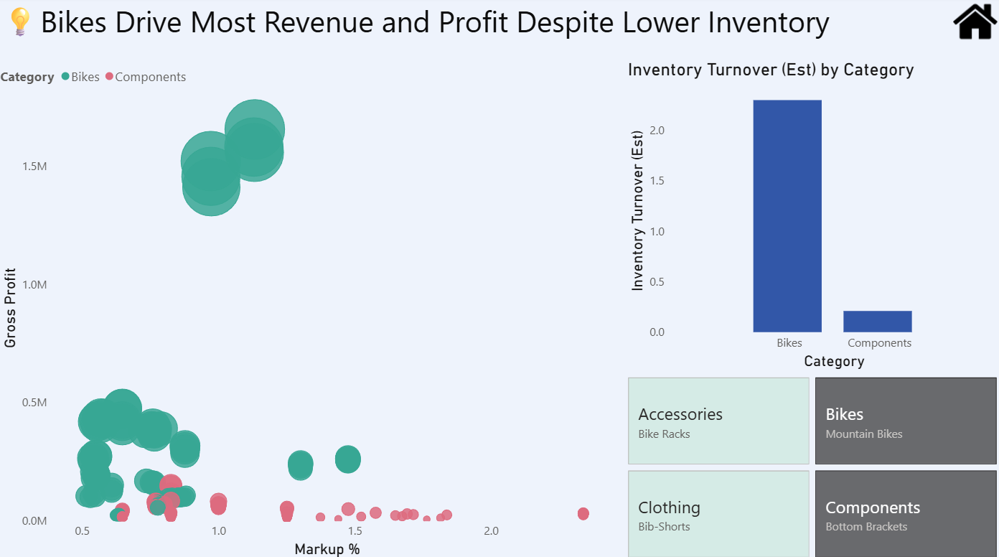

## Overview

This Power BI dashboard evaluates a proposed merger between AdventureWorks and GoBig, a company that specializes in extreme sports. The landing page lays out the case for and against the merger side by side, scores overall confidence at 7 out of 10, and recommends negotiating a 70/30 split. Each point on that page links to a supporting dashboard page.

{fig-alt="The landing page: reasons to merge, reasons not to, and a merge confidence score of 7 with a recommended 70/30 split."}

## What the data shows

- **Revenue growth has flattened.** Total revenue across the period is $66.12M with $30.19M in gross profit and an average profit of $226.26 per sale. Quarterly revenue climbed from 2019 through 2022, which is why the page reads "profitable but plateauing."
- **Margins are healthy but uneven.** Gross profit margin rose from about 40% in 2019 to about 46% by the end of 2022, while clothing profit margins stood out as a concern.

{fig-alt="Revenue, gross profit, and margin by year and quarter, with a table and bar chart toggle."}

- **Younger customers drive sales.** AdventureWorks' main demographic is males ages 20 to 30, which lines up with GoBig's customer base. Millennials and Gen Z lead revenue, although Gen Z revenue peaked in 2022 and has since fallen back below Millennials.

{fig-alt="Quarterly revenue by generation."}

- **Bikes carry the business.** Bikes generate the most revenue and profit even with lower inventory, and they turn over inventory far faster than components.

{fig-alt="Gross profit versus markup by product, with estimated inventory turnover by category."}

## Tools

Power BI, with time-intelligence measures (prior period, month-to-date, quarter-to-date, year-to-date), conditional formatting, and page-to-page navigation buttons.

<!-- PASTE (optional): replace the screenshots above with the live report.
<iframe title="Merger Sales Dashboard" width="100%" height="600" src="PASTE-POWER-BI-PUBLISH-TO-WEB-LINK-HERE" frameborder="0" allowFullScreen="true"></iframe>
-->
