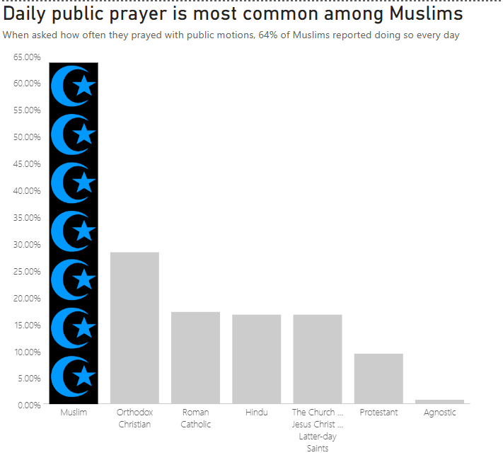
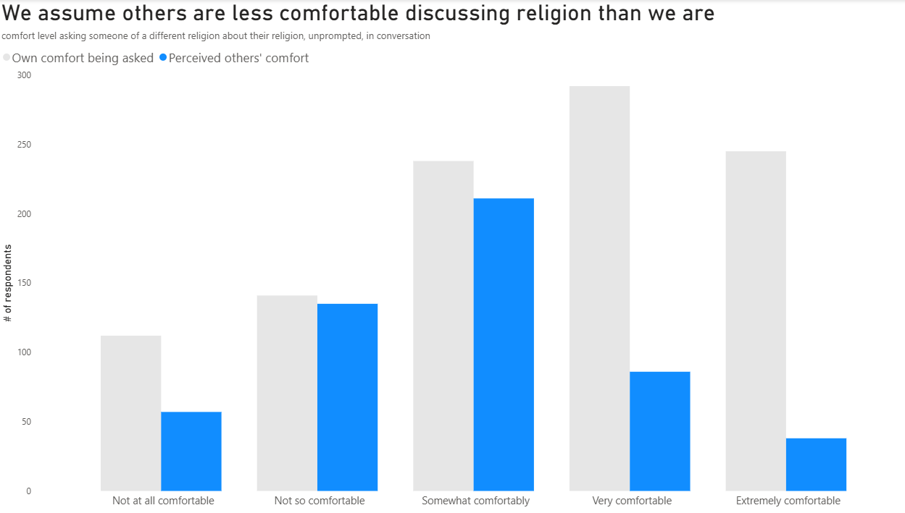
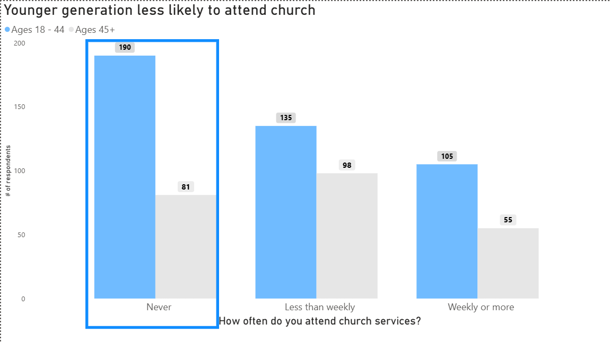
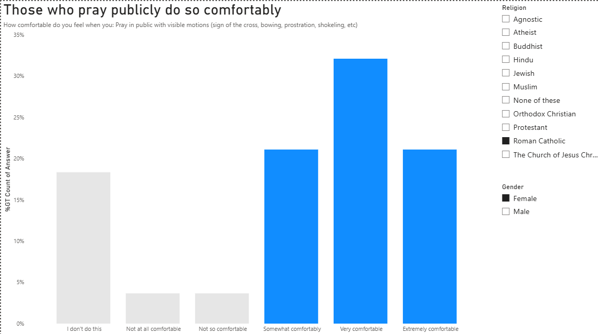
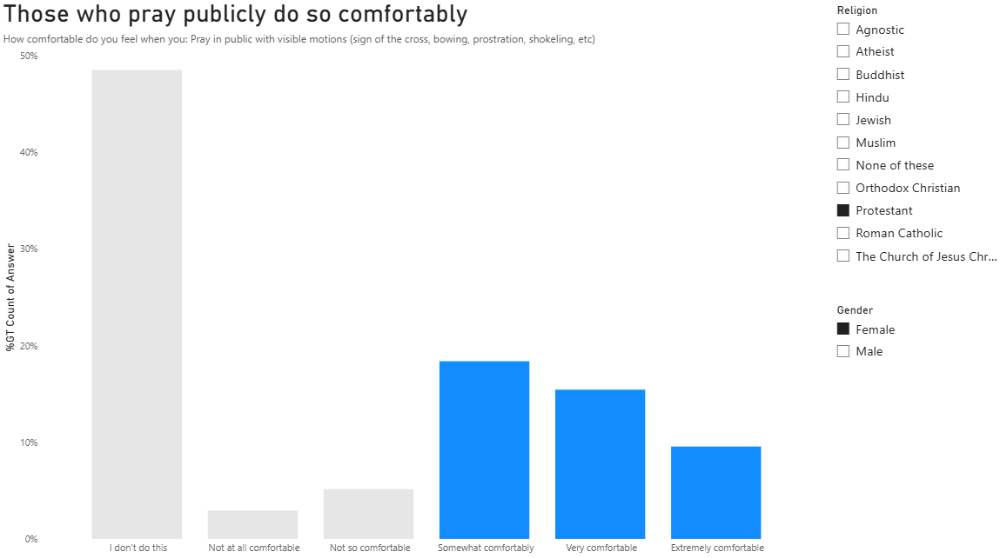
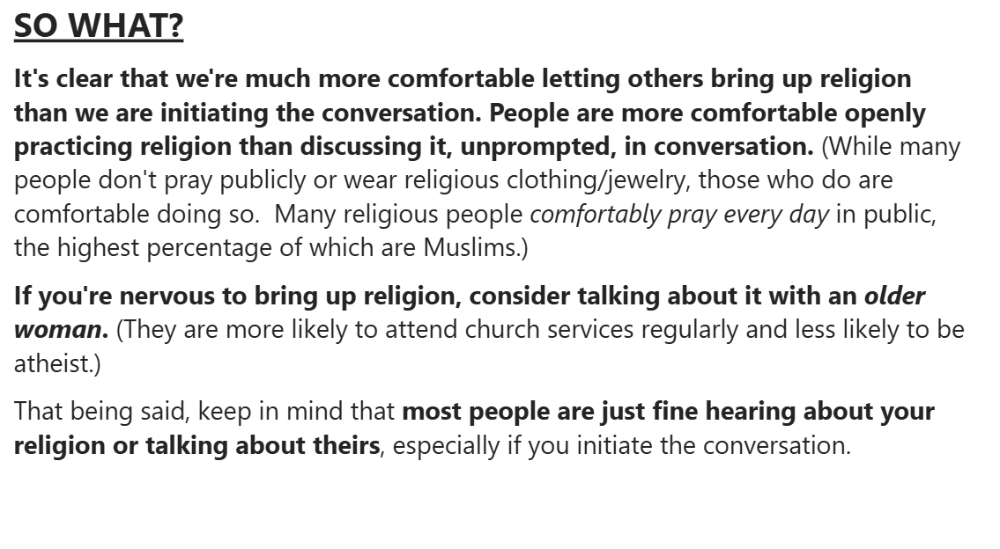

## Overview

I extracted, cleaned, and analyzed survey data on demographic patterns in religious perceptions, then built a set of Power BI views that turn the raw responses into a story a non-technical audience can follow. Each chart has a headline that states its finding, so the point is clear before anyone reads an axis.

## The story in six views

### Daily public prayer is most common among Muslims

{fig-alt="Bar chart of the share of each religion that prays with public motions every day. Muslims are highest at about 64 percent, followed by Orthodox Christians at about 28 percent, then Roman Catholics, Hindus, and Latter-day Saints at about 17 percent, Protestants at about 9 percent, and Agnostics near 1 percent."}

When asked how often they prayed with public motions, 64% of Muslims reported doing so every day. I highlighted that one bar and grayed out the rest so the comparison reads at a glance.

### We assume others are less comfortable discussing religion than we are

{fig-alt="Paired bars comparing respondents' own comfort being asked about their religion with their perception of others' comfort. Own comfort is far higher in the very and extremely comfortable groups."}

Respondents rated their own comfort being asked about their religion, unprompted, and how comfortable they think others would be. The biggest gaps are at the top of the scale: far more people say they are very or extremely comfortable themselves than expect others to be.

### Younger generation less likely to attend church

{fig-alt="Bars comparing church attendance for ages 18 to 44 and ages 45 and up. Never: 190 versus 81. Less than weekly: 135 versus 98. Weekly or more: 105 versus 55."}

The chart shows counts of respondents. Because the 18 to 44 group is larger in this sample (430 people versus 234), the share who never attend is the fairer comparison: about 44% of the younger group versus about 35% of the older group.

### Those who pray publicly do so comfortably

::: {layout-ncol=2}
{fig-alt="Comfort praying in public with visible motions among Roman Catholic women. About 18 percent say they do not do this; the rest are mostly somewhat, very, or extremely comfortable."}

{fig-alt="Comfort praying in public with visible motions among Protestant women. About half say they do not do this; those who do are somewhat, very, or extremely comfortable."}
:::

The dashboard has religion and gender filters, so a viewer can compare groups themselves. Here are two views side by side: among Roman Catholic women, about 18% say they do not pray publicly, while among Protestant women it is about half. In both groups, the people who do pray publicly mostly say they are comfortable doing it.

## So what?

{fig-alt="Summary text: people are more comfortable letting others bring up religion than starting the conversation, and more comfortable practicing religion openly than discussing it unprompted. If you are nervous to bring up religion, consider talking with an older woman. Most people are fine hearing about your religion or talking about theirs, especially if you initiate."}

The last slide connects the charts into takeaways for the audience:

- We are much more comfortable letting others bring up religion than starting the conversation, and people are more comfortable openly practicing religion than discussing it unprompted.
- If you are nervous to bring up religion, consider talking about it with an older woman. In the survey they are more likely to attend church services regularly and less likely to be atheist.
- Most people are fine hearing about your religion or talking about theirs, especially if you initiate the conversation.
